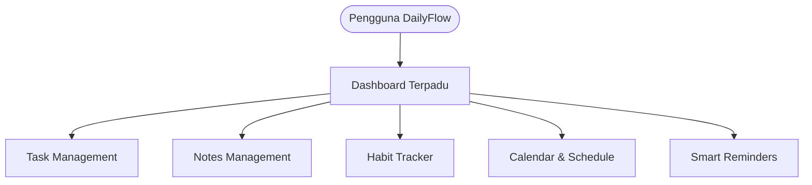
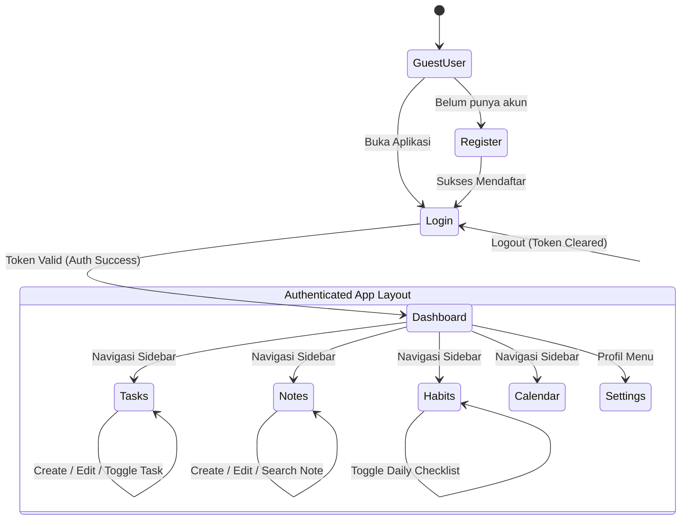
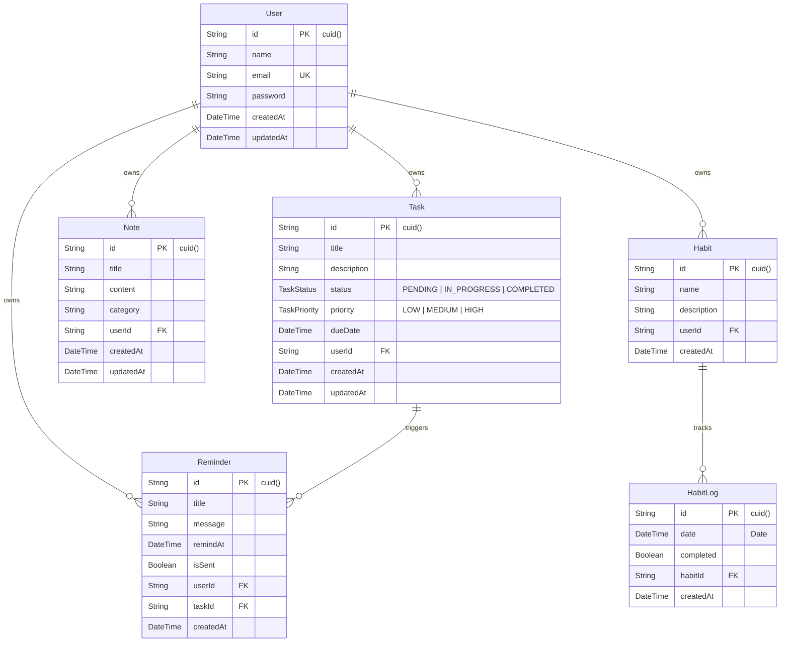
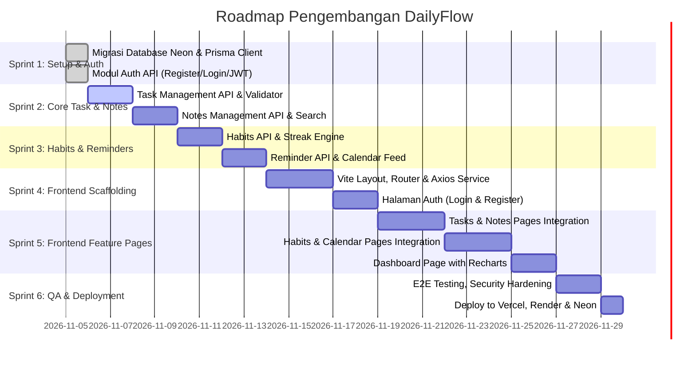

# PRODUCT REQUIREMENTS DOCUMENT (PRD)

# DAILYFLOW: All-in-One Personal Productivity System

---

## DAFTAR ISI
1. [Dokumen Kontrol & Metadata](#1-dokumen-kontrol--metadata)
2. [Ringkasan Eksekutif & Visi Produk](#2-ringkasan-eksekutif--visi-produk)
3. [User Persona & Core User Stories](#3-user-persona--core-user-stories)
4. [Ruang Lingkup Produk (Scope)](#4-ruang-lingkup-produk-scope)
5. [Arsitektur Informasi & Navigasi](#5-arsitektur-informasi--navigasi)
6. [Kebutuhan Fungsional (Functional Requirements)](#6-kebutuhan-fungsional-functional-requirements)
7. [Kebutuhan Non-Fungsional (Non-Functional Requirements)](#7-kebutuhan-non-fungsional-non-functional-requirements)
8. [Arsitektur Data & Model Database](#8-arsitektur-data--model-database)
9. [Spesifikasi & Kontrak REST API](#9-spesifikasi--kontrak-rest-api)
10. [Spesifikasi UI/UX & Komponen Frontend](#10-spesifikasi-uiux--komponen-frontend)
11. [Rencana Rilis & Milestone Roadmap](#11-rencana-rilis--milestone-roadmap)
12. [Metrik Keberhasilan (Success Metrics / KPIs)](#12-metrik-keberhasilan-success-metrics--kpis)

---

## 1. DOKUMEN KONTROL & METADATA

| Atribut | Keterangan |
|---|---|
| **Nama Dokumen** | Product Requirements Document (PRD) – DailyFlow |
| **Nama Aplikasi** | DailyFlow |
| **Versi Dokumen** | v1.0.0 |
| **Status** | Approved for Development |
| **Tanggal Terbit** | 06 November 2026 |
| **Target Rilis MVP** | Q4 2026 |
| **Penulis** | Product Lead & Software Architect |
| **Repository** | `D:\month-5\dailyflow` |

---

## 2. RINGKASAN EKSEKUTIF & VISI PRODUK

### 2.1 Problem Statement (Masalah Pengguna)
Banyak individu, pelajar, dan profesional modern mengalami fragmentasi alat produktivitas (*tool fatigue*):
- Menggunakan aplikasi terpisah untuk to-do list (misal: Todoist/TickTick).
- Aplikasi terpisah untuk pencatatan ide (misal: Notion/Keep).
- Aplikasi terpisah untuk pelacakan kebiasaan (misal: Habitica/Loop).
- Aplikasi kalender terpisah untuk jadwal (Google Calendar).

Hal ini menyebabkan:
1. **Context Switching:** Waktu dan fokus terbuang saat berpindah antar aplikasi.
2. **Ketiadaan Visibilitas Terpadu:** Pengguna tidak dapat melihat korelasi antara kebiasaan harian, beban tugas harian, dan catatan penting dalam satu dashboard ringkas.
3. **Penurunan Konsistensi:** Pengguna mudah meninggalkan kebiasaan atau melewatkan tenggat waktu karena data tersebar di berbagai platform.

### 2.2 Visi & Solusi DailyFlow
**DailyFlow** adalah aplikasi produktivitas harian all-in-one yang menyatukan **Task Management**, **Notes**, **Habit Tracker**, **Calendar View**, dan **Reminders** di bawah satu dashboard analitik interaktif.

DailyFlow dirancang dengan filosofi:
- **Clean & Focused:** Antarmuka minimalis tanpa distraksi visual.
- **Fast & Responsive:** Latensi rendah, navigasi instan Single Page Application (SPA).
- **Actionable Insights:** Menampilkan ringkasan progres harian dan streak kebiasaan secara visual.



---

## 3. USER PERSONA & CORE USER STORIES

### 3.1 User Persona

#### Persona 1: Rian Pratama (Software Engineer / Remote Worker)
- **Karakteristik:** Memiliki banyak pekerjaan harian, proyek sampingan, dan ingin menjaga rutinitas coding serta olahraga.
- **Pain Point:** Tugas kerja dan resolusi pribadi tercampur aduk; sering lupa checklist harian saat deadline padat.
- **Kebutuhan di DailyFlow:** Sistem prioritas tugas (Low, Medium, High), pelacak habit harian dengan visual streak, dan dashboard ringkas di pagi hari.

#### Persona 2: Sarah Amanda (Mahasiswa Tingkat Akhir)
- **Karakteristik:** Sibuk dengan skripsi, kelas, dan aktivitas organisasi.
- **Pain Point:** Catatan ide berserakan di aplikasi chat/buku tulis; sering terlewat tenggat waktu pengumpulan tugas.
- **Kebutuhan di DailyFlow:** Catatan terstruktur dengan kategori, deadline tugas yang terintegrasi dengan kalender, dan reminder notifikasi.

### 3.2 Core User Stories & Acceptance Criteria

| ID | As a... | I want to... | So that... | Acceptance Criteria |
|---|---|---|---|---|
| **US-01** | Pengguna Baru | Mendaftar akun dengan nama, email, dan password | Saya memiliki akun pribadi yang terisolasi aman | Validasi email unik, enkripsi password bcrypt min 6 karakter, auto-login via JWT. |
| **US-02** | Pengguna Terdaftar | Membuat tugas baru dengan deadline dan prioritas | Saya tahu apa yang harus saya selesaikan dan kapan | Tugas tersimpan dengan status PENDING, memiliki prioritas (LOW/MEDIUM/HIGH), dan muncul di list. |
| **US-03** | Pengguna Terdaftar | Mengubah status tugas menjadi COMPLETED dengan sekali klik | Saya bisa melacak progres penyelesaian pekerjaan harian | Checkbox langsung memperbarui status di database dan memicu update grafik progres dashboard. |
| **US-04** | Pengguna Terdaftar | Menulis catatan dengan judul, isi, dan kategori | Ide atau referensi penting tersimpan rapi dan mudah dicari | Catatan tersimpan, dapat difilter per kategori, dan ada fitur live search judul/isi. |
| **US-05** | Pengguna Terdaftar | Menambahkan kebiasaan baru dan mencentang keberhasilan hari ini | Saya bisa membangun konsistensi kebiasaan positif | Checklist per tanggal tersimpan unik (`HabitLog`), streak counter bertambah otomatis. |
| **US-06** | Pengguna Terdaftar | Melihat tampilan Kalender bulanan/mingguan | Saya memiliki pandangan komprehensif mengenai beban tugas ke depan | Tugas dengan due date dan reminder otomatis di-plot pada tanggal kalender yang sesuai. |
| **US-07** | Pengguna Terdaftar | Mengatur reminder pada tugas atau pengingat mandiri | Saya tidak melewatkan jadwal penting | Reminder memiliki waktu spesifik (`remindAt`) dan status penanda (`isSent`). |
| **US-08** | Pengguna Terdaftar | Membuka Dashboard setiap pagi | Saya langsung mengetahui rangkuman produktivitas hari ini | Menampilkan jumlah task pending, streak habit tertinggi, reminder hari ini, dan diagram aktivitas. |

---

## 4. RUANG LINGKUP PRODUK (SCOPE)

### 4.1 In-Scope (Fase 1 / MVP)
1. **Autentikasi & Otorisasi:**
   - Register akun baru.
   - Login & Logout berbasis JWT Token.
   - Proteksi endpoint rute privat via `authMiddleware`.
   - Endpoint `GET /api/auth/me` untuk validasi sesi aktif.
2. **Task Management:**
   - CRUD Tugas (Title, Description, Status, Priority, DueDate).
   - Filter berdasarkan status (`PENDING`, `IN_PROGRESS`, `COMPLETED`).
   - Filter berdasarkan prioritas (`LOW`, `MEDIUM`, `HIGH`).
   - Quick toggle status selesai.
3. **Notes Management:**
   - CRUD Catatan (Title, Content, Category).
   - Filter per kategori.
   - Pencarian teks pada judul dan konten catatan.
4. **Habit Tracker:**
   - CRUD Kebiasaan (Name, Description).
   - Toggle checklist per tanggal (`HabitLog`).
   - Perhitungan otomatis streak aktif (hari berturut-turut).
5. **Calendar View:**
   - Tampilan kalender grid bulanan & mingguan berbasis `date-fns`.
   - Visual dots/badges untuk tugas jatuh tempo dan reminder pada tanggal terkait.
6. **Reminder System:**
   - CRUD Reminder mandiri maupun ditautkan ke Task tertentu.
   - Penandaan status reminder (`isSent`).
7. **Dashboard Analitik:**
   - Metric cards: Total Tasks, Completed Tasks, Active Habits, Upcoming Reminders.
   - Visualisasi progres mingguan menggunakan Recharts (diagram batang / garis penyelesaian tugas).
8. **User Settings:**
   - Update profil dasar (Nama pengguna).
   - Ubah password pengguna.

### 4.2 Out-of-Scope (Fase Lanjutan / Post-MVP)
- Kolaborasi multi-user atau tim (DailyFlow v1 fokus 100% pada *personal productivity*).
- Integrasi Push Notification browser via WebSockets / Firebase Cloud Messaging (Fase 1 menggunakan in-app indicator).
- Integrasi pihak ketiga eksternal (Google Calendar API sync, Notion import).
- Dark/Light theme switching kustom (Fase 1 menggunakan modern dark-slate UI seragam).

---

## 5. ARSITEKTUR INFORMASI & NAVIGASI

### 5.1 Peta Situs (Sitemap & Page Hierarchy)

```text
DailyFlow App
├── /login                         # Halaman Masuk Akun
├── /register                      # Halaman Pendaftaran Akun Baru
└── / (Protected Layout)
    ├── /dashboard                 # Ringkasan statistik, streak, deadline, chart
    ├── /tasks                     # Manajemen daftar tugas, filter status/priority
    ├── /notes                     # Manajemen catatan, filter kategori, live search
    ├── /habits                    # Pelacak habit, grid matriks harian, streak counter
    ├── /calendar                  # Kalender visual penggabungan task & reminder
    ├── /reminders                 # Daftar pengingat terjadwal
    └── /settings                  # Pengaturan akun pengguna & keamanan kata sandi
```

### 5.2 Alur Pengguna (User Navigation Flow)



---

## 6. KEBUTUHAN FUNGSIONAL (FUNCTIONAL REQUIREMENTS)

### 6.1 Modul 1: Autentikasi & Akun Pengguna (AUTH)
- **FR-AUTH-01:** Sistem wajib menyediakan formulir pendaftaran dengan field: Nama, Email, dan Password.
- **FR-AUTH-02:** Sistem wajib memvalidasi format email dan memastikan email belum pernah terdaftar sebelumnya (Unique Constraint).
- **FR-AUTH-03:** Password wajib memiliki panjang minimal 6 karakter dan di-hash menggunakan algoritma `bcrypt` dengan cost factor 12 sebelum disimpan ke database.
- **FR-AUTH-04:** Sistem wajib mengeluarkan token JWT dengan masa berlaku 7 hari setelah login berhasil.
- **FR-AUTH-05:** Setiap request ke rute privat wajib menyertakan token JWT pada header `Authorization: Bearer <token>`.
- **FR-AUTH-06:** Sistem wajib menyediakan endpoint verifikasi token (`GET /api/auth/me`) untuk menjaga sesi login saat halaman di-refresh.

### 6.2 Modul 2: Manajemen Tugas (TASKS)
- **FR-TASK-01:** Pengguna dapat membuat tugas baru dengan parameter:
  - `title` (Wajib, string 1-255 karakter).
  - `description` (Opsional, teks panjang).
  - `priority` (Enum: `LOW`, `MEDIUM`, `HIGH`; default: `MEDIUM`).
  - `status` (Enum: `PENDING`, `IN_PROGRESS`, `COMPLETED`; default: `PENDING`).
  - `dueDate` (Opsional, format ISO DateTime).
- **FR-TASK-02:** Pengguna dapat melihat daftar tugas miliknya dengan opsi filter berdasarkan `status` dan `priority`.
- **FR-TASK-03:** Pengguna dapat memperbarui rincian tugas dan mengubah status penyelesaian dengan sekali klik (*quick toggle*).
- **FR-TASK-04:** Pengguna dapat menghapus tugas secara permanen.
- **FR-TASK-05:** Sistem wajib mengisolasi data tugas sehingga pengguna hanya dapat membaca, mengubah, dan menghapus tugas milik dirinya sendiri (`userId = req.user.id`).

### 6.3 Modul 3: Manajemen Catatan (NOTES)
- **FR-NOTE-01:** Pengguna dapat membuat catatan baru dengan parameter:
  - `title` (Wajib, string 1-255 karakter).
  - `content` (Opsional, teks bebas / markdown-ready string).
  - `category` (Opsional, string kategori seperti "Pekerjaan", "Kuliah", "Pribadi", "Ide").
- **FR-NOTE-02:** Pengguna dapat melihat seluruh catatan dalam tampilan grid card yang responsif.
- **FR-NOTE-03:** Pengguna dapat melakukan pencarian *real-time* berbasis kata kunci pada judul maupun konten catatan.
- **FR-NOTE-04:** Pengguna dapat mengedit isi catatan dan memperbarui kategori.
- **FR-NOTE-05:** Pengguna dapat menghapus catatan miliknya.

### 6.4 Modul 4: Pelacak Kebiasaan (HABIT TRACKER)
- **FR-HABIT-01:** Pengguna dapat membuat kebiasaan baru dengan nama (`name`) dan deskripsi singkat (`description`).
- **FR-HABIT-02:** Sistem wajib mencatat status penyelesaian kebiasaan per hari dalam tabel `HabitLog`.
- **FR-HABIT-03:** Sistem wajib mencegah duplikasi entri log untuk kebiasaan dan tanggal yang sama melalui database constraint `unique([habitId, date])`.
- **FR-HABIT-04:** Pengguna dapat melakukan *toggle* status checklist (centang / batalkan centang) untuk hari ini maupun tanggal sebelumnya.
- **FR-HABIT-05:** Sistem wajib menghitung *Current Streak* (jumlah hari berurutan kebiasaan tersebut diselesaikan hingga hari ini/kemarin).
- **FR-HABIT-06:** Tampilan antarmuka menampilkan matriks grid 7 hari terakhir / bulan aktif untuk visualisasi konsistensi.

### 6.5 Modul 5: Kalender & Agenda (CALENDAR)
- **FR-CAL-01:** Antarmuka kalender menampilkan grid bulanan (Month View) dan daftar agenda mingguan (Week View).
- **FR-CAL-02:** Sistem mengagregasi data `Task` yang memiliki `dueDate` serta data `Reminder` yang memiliki `remindAt` ke dalam tanggal kalender yang sesuai.
- **FR-CAL-03:** Setiap entri pada kalender memiliki indikator visual warna berdasarkan prioritas tugas (Merah = High, Kuning = Medium, Hijau = Low/Completed).
- **FR-CAL-04:** Mengklik tanggal tertentu pada kalender akan membuka panel popover rincian tugas & pengingat yang jatuh tempo pada hari tersebut.

### 6.6 Modul 6: Pengingat (REMINDERS)
- **FR-REM-01:** Pengguna dapat membuat pengingat mandiri dengan judul (`title`), pesan opsional (`message`), dan waktu spesifik (`remindAt`).
- **FR-REM-02:** Pengguna dapat menautkan pengingat ke tugas tertentu melalui `taskId` (relasi opsional).
- **FR-REM-03:** Pengguna dapat menandai pengingat sebagai telah selesai / terbaca (`isSent = true`).
- **FR-REM-04:** Pengingat yang jatuh tempo hari ini ditampilkan pada widget khusus di Dashboard.

### 6.7 Modul 7: Dashboard Terpadu (DASHBOARD)
- **FR-DASH-01:** Dashboard menyediakan kartu metrik (*Metric Cards*):
  - Total Tugas Aktif (Pending & In Progress).
  - Tingkat Penyelesaian Tugas Hari Ini (% Completed).
  - Kebiasaan Aktif & Rata-rata Streak.
  - Pengingat & Tenggat Waktu Hari Ini.
- **FR-DASH-02:** Visualisasi grafik mingguan menggunakan `Recharts`:
  - Grafik batang (Bar Chart) menampilkan jumlah tugas yang diselesaikan per hari dalam 7 hari terakhir.
- **FR-DASH-03:** Daftar aksi cepat (*Quick Actions*): tombol shortcut tambah task baru, tambah catatan, dan toggle habit tanpa meninggalkan dashboard.

### 6.8 Modul 8: Pengaturan Pengguna (SETTINGS)
- **FR-SET-01:** Pengguna dapat memperbarui nama profilnya.
- **FR-SET-02:** Pengguna dapat mengganti password dengan memverifikasi password lama terlebih dahulu.
- **FR-SET-03:** Menampilkan ringkasan akun (Email terdaftar, tanggal bergabung / `createdAt`).

---

## 7. KEBUTUHAN NON-FUNGSIONAL (NON-FUNCTIONAL REQUIREMENTS)

### 7.1 Performa & Kecepatan (Performance)
- **Waktu Respon API:** Rata-rata waktu respon backend untuk operasi CRUD harus di bawah 150ms pada kondisi database *warm*.
- **Mitigasi Cold Start Neon:** Pengaturan koneksi `DATABASE_URL` wajib menyertakan timeout minimal `connect_timeout=15` agar query backend tidak memicu error `P1001` saat komputasi serverless Neon terbangun dari kondisi suspensi (*scale-to-zero*).
- **Frontend Bundle Size:** Bundle build produksi Vite harus di bawah 500 kB (gzipped) dengan *code-splitting* dinamis pada level rute halaman.

### 7.2 Keamanan (Security)
- **Enkripsi Data Sensitif:** Password pengguna tidak boleh disimpan dalam bentuk plain text; wajib di-hash menggunakan `bcryptjs` (salt rounds 12).
- **Autentikasi Aman:** Token JWT ditandatangani dengan algoritma HS256 menggunakan secret rahasia (`JWT_SECRET`) berkekuatan tinggi.
- **Validasi Input Ketat:** Seluruh request body dan query parameters wajib divalidasi oleh skema `Zod` sebelum dieksekusi ke database.
- **Perlindungan CORS:** Backend hanya menerima origin dari domain frontend yang sah (`process.env.FRONTEND_URL`), mencegah eksploitasi cross-origin.
- **Isolasi Multi-Tenant:** Semua query database yang memanipulasi Task, Note, Habit, HabitLog, dan Reminder wajib menyertakan filter `userId = req.user.id` dari token JWT terverifikasi.

### 7.3 Ketersediaan & Keandalan (Reliability & Availability)
- **Koneksi Database Singleton:** Menggunakan satu instance PrismaClient singleton untuk menghindari *connection exhaustion* pada PostgreSQL Neon.
- **Cascading Integrity:** Menghapus akun User akan secara otomatis menghapus Task, Note, Habit, dan Reminder terkait (`onDelete: Cascade`), menjaga integritas data tanpa *orphaned records*.
- **Standardized Error Handling:** Kesalahan runtime backend ditangkap oleh centralized error middleware dan dikembalikan dalam format JSON standar, tidak mengekspos stack trace internal ke client.

### 7.4 Kompatibilitas & Desain Responsif (Usability & Responsiveness)
- Antarmuka web harus responsif penuh (*Mobile-First Responsive*) dan dapat dioperasikan secara optimal pada resolusi layar smartphone (min 375px), tablet, dan desktop (hingga 1920px+).
- Kompatibel dengan peramban modern: Chrome, Firefox, Safari, Edge versi 2 tahun terakhir.

---

## 8. ARSITEKTUR DATA & MODEL DATABASE

Database menggunakan PostgreSQL yang di-host pada Neon Serverless dengan Prisma ORM v6.



### Kamus Data & Indexing Strategy:
1. **Model `User`:**
   - `id`: Primary key CUID.
   - `email`: Unik (`@unique`), diindeks otomatis oleh database B-Tree untuk login instan.
2. **Model `Task`:**
   - Composite Index `@@index([userId, status])`: Mengoptimalkan filter daftar tugas aktif/selesai per pengguna.
   - Index `@@index([userId])`: Mempercepat join dan isolasi data per akun.
3. **Model `HabitLog`:**
   - Composite Unique `@@unique([habitId, date])`: Menjamin satu habit hanya memiliki satu status checklist per hari kalender.
4. **Model `Reminder`:**
   - Composite Index `@@index([remindAt, isSent])`: Mempercepat query polling reminder yang akan datang dan belum terkirim.

---

## 9. SPESIFIKASI & KONTRAK REST API

Format respon standar untuk seluruh endpoint:
```json
// Respon Sukses
{
  "success": true,
  "message": "Deskripsi aksi sukses",
  "data": {} // atau []
}

// Respon Gagal / Error
{
  "success": false,
  "message": "Pesan error spesifik",
  "errors": {} // opsional, rincian validasi field
}
```

### 9.1 Endpoint Autentikasi (`/api/auth`)

| Method | Endpoint | Auth | Request Body | Response Sukses | HTTP Status |
|---|---|---|---|---|---|
| `POST` | `/api/auth/register` | No | `{ name, email, password }` | `{ user: { id, name, email }, token }` | 201 Created |
| `POST` | `/api/auth/login` | No | `{ email, password }` | `{ user: { id, name, email }, token }` | 200 OK |
| `GET` | `/api/auth/me` | Bearer | None | `{ user: { id, name, email, createdAt } }` | 200 OK |
| `PUT` | `/api/auth/profile` | Bearer | `{ name }` | `{ user: { id, name, email } }` | 200 OK |
| `PUT` | `/api/auth/password` | Bearer | `{ currentPassword, newPassword }`| `{ message: "Password updated" }` | 200 OK |

### 9.2 Endpoint Tugas (`/api/tasks`)

| Method | Endpoint | Auth | Query / Request Body | Response Sukses | HTTP Status |
|---|---|---|---|---|---|
| `GET` | `/api/tasks` | Bearer | Query: `status`, `priority`, `search` | Array data Task milik user | 200 OK |
| `POST` | `/api/tasks` | Bearer | `{ title, description?, status?, priority?, dueDate? }` | Objek Task baru | 201 Created |
| `GET` | `/api/tasks/:id` | Bearer | Param: `id` | Objek rincian Task | 200 OK |
| `PUT` | `/api/tasks/:id` | Bearer | `{ title?, description?, status?, priority?, dueDate? }` | Objek Task terupdate | 200 OK |
| `PATCH`| `/api/tasks/:id/status`| Bearer | `{ status: "COMPLETED" \| "PENDING" }` | Objek Task terupdate | 200 OK |
| `DELETE`| `/api/tasks/:id`| Bearer | Param: `id` | Pesan sukses penghapusan | 200 OK |

### 9.3 Endpoint Catatan (`/api/notes`)

| Method | Endpoint | Auth | Query / Request Body | Response Sukses | HTTP Status |
|---|---|---|---|---|---|
| `GET` | `/api/notes` | Bearer | Query: `category`, `search` | Array data Note milik user | 200 OK |
| `POST` | `/api/notes` | Bearer | `{ title, content?, category? }` | Objek Note baru | 201 Created |
| `GET` | `/api/notes/:id` | Bearer | Param: `id` | Objek rincian Note | 200 OK |
| `PUT` | `/api/notes/:id` | Bearer | `{ title?, content?, category? }` | Objek Note terupdate | 200 OK |
| `DELETE`| `/api/notes/:id`| Bearer | Param: `id` | Pesan sukses penghapusan | 200 OK |

### 9.4 Endpoint Kebiasaan (`/api/habits`)

| Method | Endpoint | Auth | Query / Request Body | Response Sukses | HTTP Status |
|---|---|---|---|---|---|
| `GET` | `/api/habits` | Bearer | Query: `startDate`, `endDate` | Array Habit lengkap dengan logs & streak | 200 OK |
| `POST` | `/api/habits` | Bearer | `{ name, description? }` | Objek Habit baru | 201 Created |
| `POST` | `/api/habits/:id/toggle` | Bearer | `{ date: "YYYY-MM-DD", completed: boolean }` | Objek HabitLog ter-upsert | 200 OK |
| `DELETE`| `/api/habits/:id`| Bearer | Param: `id` | Pesan sukses penghapusan | 200 OK |

### 9.5 Endpoint Pengingat & Kalender (`/api/reminders` & `/api/dashboard`)

| Method | Endpoint | Auth | Query / Request Body | Response Sukses | HTTP Status |
|---|---|---|---|---|---|
| `GET` | `/api/reminders` | Bearer | None | Array Reminder milik user | 200 OK |
| `POST` | `/api/reminders` | Bearer | `{ title, message?, remindAt, taskId? }` | Objek Reminder baru | 201 Created |
| `PATCH`| `/api/reminders/:id/status`| Bearer| `{ isSent: boolean }` | Objek Reminder terupdate | 200 OK |
| `DELETE`| `/api/reminders/:id` | Bearer | Param: `id` | Pesan sukses penghapusan | 200 OK |
| `GET` | `/api/dashboard` | Bearer | None | Ringkasan metrik statistik terpadu | 200 OK |

---

## 10. SPESIFIKASI UI/UX & KOMPONEN FRONTEND

### 10.1 Skema Warna & Desain Visual (Theme System)
- **Tema Utama:** Modern Productivity Dark Palette.
- **Warna Latar Belakang:** Slate Dark (`#0f172a` & `#1e293b`).
- **Warna Aksen:** Royal Indigo / Electric Violet (`#6366f1` / `#4f46e5`).
- **Status Colors:**
  - Success / Completed: Emerald (`#10b981`).
  - Warning / In Progress: Amber (`#f59e0b`).
  - Danger / High Priority: Rose (`#f43f5e`).
  - Info / Medium Priority: Sky Blue (`#0ea5e9`).
- **Typography:** Inter / sans-serif sistem, rendering font tajam dan mudah dibaca pada ukuran kecil.

### 10.2 Struktur Tata Letak (Layout Hierarchy)

```text
+-----------------------------------------------------------------------------------+
|  DailyFlow Logo   |  Search Bar Global               |  User Avatar & Logout      |
+-------------------+----------------------------------+----------------------------+
|  SIDEBAR          |  MAIN CONTENT AREA                                            |
|  - Dashboard      |  +----------------------------------------------------------+ |
|  - Tasks          |  |  Page Header & Action Button (e.g. "+ Tambah Tugas")     | |
|  - Notes          |  +----------------------------------------------------------+ |
|  - Habits         |  |                                                          | |
|  - Calendar       |  |  Content Grid / Tables / Cards / Charts                  | |
|  - Reminders      |  |                                                          | |
|  - Settings       |  |                                                          | |
|                   |  +----------------------------------------------------------+ |
+-------------------+---------------------------------------------------------------+
```

### 10.3 State Handling pada Frontend
1. **Loading State:**
   - Gunakan animated skeleton loader pada saat memuat kartu task, catatan, dan metrik dashboard (tidak menggunakan spinner layar penuh yang membekukan interaksi).
2. **Empty State:**
   - Ketika pengguna belum memiliki data (misal: belum ada catatan), tampilkan ilustrasi ikon yang relevan dari `lucide-react`, pesan motivasi ramah, dan tombol Call-to-Action (CTA) langsung.
3. **Error State & Toast Notifications:**
   - Toast notification (pop-up sudut kanan atas) untuk konfirmasi aksi sukses ("Tugas berhasil dibuat", "Catatan disimpan") dan penanganan kegagalan jaringan.
4. **Optimistic Updates:**
   - Pada checklist tugas dan toggle habit, UI langsung diperbarui seketika (*optimistic UI*), lalu mengirim request di background agar interaksi terasa tanpa jeda bagi pengguna.

---

## 11. RENCANA RILIS & MILESTONE ROADMAP



### Rincian Sprints:
- **Sprint 1 (Fondasi & Auth):** Migrasi database Neon, Prisma Client singleton, Modul Registrasi, Login, Hash Password, dan JWT Middleware. *(Status: Selesai di Backend)*
- **Sprint 2 (Task & Note API):** Penyelesaian endpoint CRUD Task dan Notes beserta validasi Zod lengkap.
- **Sprint 3 (Habits, Reminders, Dashboard API):** Endpoint habit tracker dengan streak calculation, reminder scheduling, dan agregasi statistik dashboard.
- **Sprint 4 (Frontend Scaffolding & Auth UI):** Konfigurasi React Router DOM v7, Layout Sidebar/Header responsif, AuthContext global, Axios interceptor, dan halaman Login/Register.
- **Sprint 5 (Frontend Integration):** Pembuatan halaman interaktif Tasks, Notes, Habits Matrix, Calendar, dan Dashboard analitik (Recharts).
- **Sprint 6 (Testing & Production Release):** Linting, build optimization, proteksi Helmet/Rate Limiting, konfigurasi deployment di Vercel (Frontend) dan Render (Backend).

---

## 12. METRIK KEBERHASILAN (SUCCESS METRICS / KPIS)

Untuk mengukur efektivitas dan keberhasilan produk DailyFlow:

| Kategori Metrik | KPI Target | Pengukuran |
|---|---|---|
| **Adopsi Pengguna** | > 80% aktivasi user baru | Pengguna baru yang mendaftar membuat setidaknya 1 task dan 1 habit dalam 24 jam pertama. |
| **Konsistensi Kebiasaan** | Rata-rata 5 hari streak | Pengguna aktif mempertahankan pelacakan kebiasaan harian secara berkelanjutan. |
| **Kecepatan & Performa** | P95 API Latency < 200ms | 95% request backend selesai dalam waktu kurang dari 200 milidetik. |
| **Stabilitas Sistem** | Error Rate < 0.5% | Jumlah request HTTP yang menghasilkan status 500 di bawah 0.5% dari total traffic. |
| **Frontend Responsiveness** | Skor Google Lighthouse > 90 | Kategori Performance, Accessibility, dan Best Practices pada browser desktop & mobile. |

---

## 13. TANDA TANGAN PERSETUJUAN (SIGN-OFF)

Dokumen ini menjadi acuan spesifikasi tunggal (*Single Source of Truth*) bagi tim rekayasa perangkat lunak dalam mengeksekusi arsitektur dan pengembangan fitur aplikasi DailyFlow.

| Peran | Nama | Status | Tanggal |
|---|---|---|---|
| **Lead Architect** | AI Senior Full-Stack Engineer | Approved | 06 November 2026 |
| **Product Owner** | User (Project DailyFlow) | Pending Review | 06 November 2026 |

